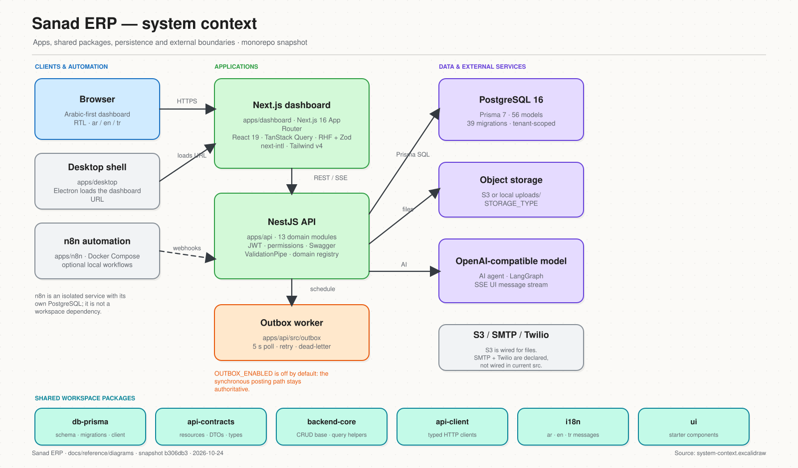
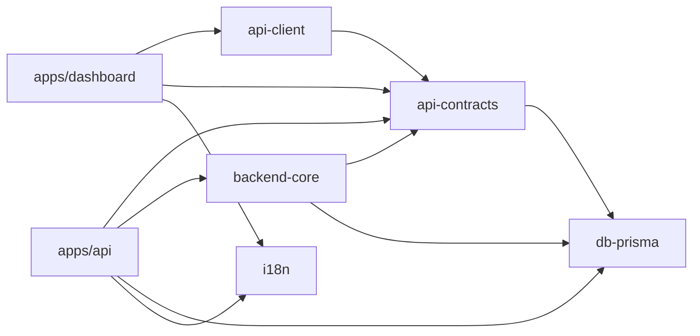

# 01 · Monorepo Map

The top-level shape, the packages that actually participate in the build, and the dependency direction between them.

> Snapshot: `b306db3` · 2026-10-24. Paths are relative to the repository root.

---

## Top-level tree

```text
erp/
├── apps/
│   ├── api/                    NestJS REST API (13 domain modules)
│   ├── dashboard/              Next.js App Router dashboard
│   ├── desktop/                Electron wrapper around the dashboard URL
│   └── n8n/                    Optional Docker Compose automation stack
├── packages/
│   ├── api-client/             Typed HTTP clients + React Query bindings
│   ├── api-contracts/          Resource definitions, DTOs, permissions, generated types
│   ├── backend-core/           NestJS CRUD base classes + response/query infrastructure
│   ├── db-prisma/              Split Prisma schema, migrations, seed, generated client
│   ├── eslint-config/          Shared ESLint configuration
│   ├── i18n/                   ar / en / tr messages + Nest and next-intl adapters
│   ├── typescript-config/      Shared tsconfig bases
│   ├── ui/                     Minimal starter components (not the main design system)
│   ├── contracts/              Build artifact only (dist/, no package.json)
│   └── import-export/          Build artifact only (dist/, no package.json)
├── docs/
│   ├── reference/              ← this atlas
│   ├── adr/                    Architecture decision records
│   ├── agents/                 Issue tracker + triage docs
│   └── *.md                    Historical narrative docs
├── scripts/                    Contract mirrors, lint guards, skill sync
├── .ai/                        Canonical rules and skills for agents
├── .claude/  .cursor/  .opencode/   Tool-specific AI configuration
├── .github/                    CI / repository automation
├── AGENTS.md                   Agent entry point
├── CONTEXT.md                  Domain vocabulary / context
├── CONTRIBUTING.md             Setup + contribution workflow
├── PRODUCT.md  DESIGN.md  ROADMAP.md
├── docker-compose.yml          PostgreSQL 16 for local development (host port 5435)
├── turbo.json                  Turborepo task graph
├── pnpm-workspace.yaml         Workspace globs: apps/*, packages/*
└── package.json                Root scripts (build, dev, lint, generate, …)
```

### What to ignore when exploring

| Path                                                       | Why                                         |
| ---------------------------------------------------------- | ------------------------------------------- |
| `node_modules/`                                            | pnpm store links.                           |
| `.next/`, `dist/`, `.turbo/`                               | Build output and cache.                     |
| `packages/db-prisma/generated/`                            | Generated Prisma client.                    |
| `.impeccable/`, `.remember/`                               | Local tool caches, not product code.        |
| `.opencode/node_modules/`                                  | OpenCode's own tool dependencies.           |
| `packages/contracts/dist/`, `packages/import-export/dist/` | Orphan build output with no current source. |

---

## System context



_Editable: [`diagrams/system-context.excalidraw`](diagrams/system-context.excalidraw)._

---

## Active workspaces

| Package                         | Path                         | Runtime               | Owns                                                                                                        |
| ------------------------------- | ---------------------------- | --------------------- | ----------------------------------------------------------------------------------------------------------- |
| `@devloggers/api`               | `apps/api`                   | Node / NestJS 11      | HTTP endpoints, auth, domain rules, GL posting, stock movements, AI agent, outbox.                          |
| `@devloggers/dashboard`         | `apps/dashboard`             | Next.js 16 / React 19 | Routes, resource pages, forms, tables, dashboard shell, i18n UI.                                            |
| `@devloggers/desktop`           | `apps/desktop`               | Electron              | Browser window that loads the dashboard URL.                                                                |
| `@devloggers/n8n`               | `apps/n8n`                   | Docker Compose        | Isolated n8n + PostgreSQL for automation experiments.                                                       |
| `@devloggers/db-prisma`         | `packages/db-prisma`         | Node / Prisma 7       | Schema, migrations, seed, generated client, `PrismaService`.                                                |
| `@devloggers/api-contracts`     | `packages/api-contracts`     | Isomorphic TS         | Resource route definitions, DTOs, permission catalog, settings registry, generated OpenAPI types.           |
| `@devloggers/backend-core`      | `packages/backend-core`      | Node / NestJS         | `CrudRepository`, `CrudService`, `CrudPresenter`, `createCrudController`, envelope, filters, import/export. |
| `@devloggers/api-client`        | `packages/api-client`        | Browser / Node        | `ApiClient`, `CrudClient`, typed clients, `createApi()`, React hooks.                                       |
| `@devloggers/i18n`              | `packages/i18n`              | Both                  | Translation JSON and framework adapters.                                                                    |
| `@devloggers/ui`                | `packages/ui`                | React                 | Three starter components; not imported by the dashboard feature modules.                                    |
| `@devloggers/eslint-config`     | `packages/eslint-config`     | Dev only              | Lint rules.                                                                                                 |
| `@devloggers/typescript-config` | `packages/typescript-config` | Dev only              | Base tsconfigs.                                                                                             |

---

## Dependency direction



Rules implied by the graph:

1. `api-contracts` never depends on `api` or `dashboard`.
2. `api-client` never imports `apps/api`; it consumes generated HTTP types only.
3. `backend-core` is infrastructure, not a domain module.
4. The dashboard talks to the API through `api-client` or `shared/api.ts`, never by importing Nest services.
5. Shared types belong in `api-contracts`; do not duplicate an API shape in a component.

---

## Boot sequence

```text
pnpm dev
  ├── apps/api        NestFactory.create(AppModule)
  │     ├── ConfigModule loads .env.<NODE_ENV>
  │     ├── PrismaModule connects
  │     ├── domain registry resolves DISABLED_DOMAINS
  │     ├── ValidationPipe + guards + exception filters
  │     ├── Swagger document built
  │     └── in development: writes openapi.yaml + api-contracts types
  └── apps/dashboard  next dev
        ├── next-intl locale routing
        ├── Providers: theme → React Query → ApiProvider
        └── client modules call useApi()
```

Important: the API's development bootstrap **regenerates the committed contract** on every restart. If contract generation fails, startup fails. That is intentional.

---

## Commands that matter

| Goal                        | Command                                              |
| --------------------------- | ---------------------------------------------------- |
| Install                     | `pnpm install`                                       |
| Start PostgreSQL            | `docker compose up -d db`                            |
| Migrate                     | `pnpm --filter @devloggers/db-prisma db:migrate:dev` |
| Seed                        | `pnpm --filter @devloggers/db-prisma db:seed`        |
| Run API                     | `pnpm --filter @devloggers/api dev`                  |
| Run dashboard               | `pnpm --filter @devloggers/dashboard dev`            |
| Regenerate contract + types | `pnpm generate`                                      |
| Build contracts             | `pnpm --filter @devloggers/api-contracts build`      |
| Build clients               | `pnpm --filter @devloggers/api-client build`         |
| Lint API                    | `pnpm --filter @devloggers/api lint`                 |
| Test API                    | `pnpm --filter @devloggers/api test`                 |
| Lint dashboard              | `pnpm --filter @devloggers/dashboard lint`           |
| Typecheck dashboard         | `pnpm --filter @devloggers/dashboard typecheck`      |
| Regenerate diagrams         | `node docs/reference/diagrams/build-diagrams.mjs`    |

### Known script sharp edges

These are existing drift points, not recommendations:

- `apps/dashboard` `predev` / `prebuild` call `pnpm --filter @devloggers/api run generate`, but the API package publishes `generate:spec`, not `generate`. If the hook fails, run root `pnpm generate` once, then start Next directly:
  ```bash
  pnpm generate
  pnpm --filter @devloggers/dashboard exec next dev --turbopack
  ```
- `apps/api` `db:*` scripts `cd ../../packages/db`, but the database package is `packages/db-prisma`.
- `docs/file-structure.md` lists a root `reference/` directory and older module names; this atlas reflects the actual tree.

---

## Where ownership starts

| Change                                 | Start in                                                                      |
| -------------------------------------- | ----------------------------------------------------------------------------- |
| A new database model                   | `packages/db-prisma/src/schema/`                                              |
| A new HTTP resource                    | `packages/api-contracts/src/resources/`, then `apps/api/src/modules/`         |
| A new endpoint on an existing resource | Its module under `apps/api/src/modules/<domain>/<resource>/`                  |
| A new dashboard screen                 | `apps/dashboard/app/[locale]/(authenticated)/...` + `apps/dashboard/modules/` |
| A new shared UI primitive              | `apps/dashboard/shared/components/ui/`                                        |
| A new translation                      | `packages/i18n/src/<locale>/`                                                 |
| A cross-cutting type                   | `packages/api-contracts/src/`                                                 |
| A domain dependency                    | `apps/api/src/domain/manifest.ts` + `domain-modules.ts`                       |
