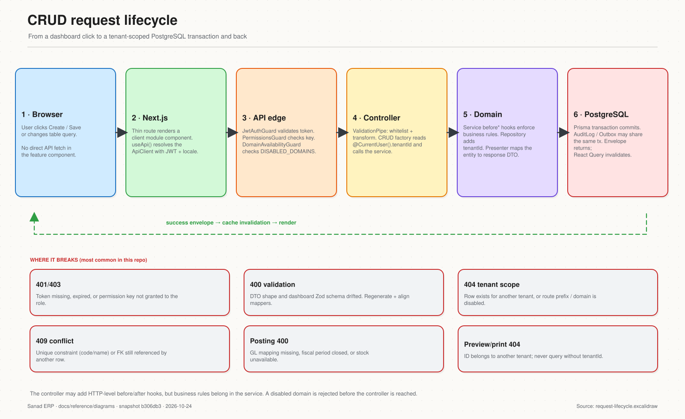

# 02 · API Atlas

`apps/api` is a NestJS 11 application with **13 domain modules**, a generated OpenAPI contract, tenant-scoped CRUD, and a handful of transaction-heavy flows (invoicing, stock, GL posting, business setup, AI).

> Snapshot: `b306db3` · 2026-10-24. For exact endpoints, use [`apps/api/openapi.yaml`](../../apps/api/openapi.yaml) or the running Swagger UI.

---

## Directory shape

```text
apps/api/
├── src/
│   ├── main.ts                 bootstrap, Swagger, cookie parser, CORS, contract write
│   ├── app.module.ts           global config, event bus, schedule, Prisma, guards, filters
│   ├── config/                 configuration.ts + Joi env validator
│   ├── common/                 envelope, query utils, decorators, request context, logging
│   ├── contracts/              OpenAPI document builder + contract writer
│   ├── domain/                 capability manifest, module composition, disabled-domain guards
│   ├── outbox/                 durable outbox repository, worker, handler registry
│   ├── modules/                domain modules (see table below)
│   └── …                       tests are colocated as *.spec.ts
├── scripts/                    contract + domain-manifest checks
├── test/                       e2e configuration location
├── openapi.yaml                generated contract (committed)
├── .env.development            local env (not gitignored)
└── package.json
```

`src/modules/` is the **domain layer**; `src/domain/manifest.ts` is the **composition layer**. Do not add a new top-level domain without updating the manifest, `domain-modules.ts`, and the route prefixes.

---

## Domain registry

| Domain          | Module files\* | Route prefixes owned                                                                                                                                                                                                                                 | Optional? | Depends on                                       |
| --------------- | -------------: | ---------------------------------------------------------------------------------------------------------------------------------------------------------------------------------------------------------------------------------------------------- | --------- | ------------------------------------------------ |
| `accounting`    |             98 | `/accounting/chart-of-accounts`, `/accounting/account-balances`, `/accounting/opening-balance-sessions`, `/accounting/journal-entries`, `/accounting/reconciliation`, `/currencies`, `/fiscal-periods`, `/document-sequences`, `/settings/financial` | No        | `audit`                                          |
| `identity`      |            102 | `/auth`, `/users`, `/tenants`, `/roles`, `/onboarding`, `/business-setup`, `/settings`, `/settings/danger`                                                                                                                                           | No        | `accounting`, `catalog`, `invoicing`, `platform` |
| `catalog`       |             88 | `/units`, `/brands`, `/tags`, `/tag-assignments`, `/items`, `/item-categories`, `/item-relations`, `/catalog-entities`, `/item-catalog-entities`                                                                                                     | No        | `custom-fields`, `inventory`, `platform`         |
| `invoicing`     |             61 | `/invoices`, `/payments`, `/expenses`, `/cashboxes`, `/bank-accounts`, `/invoice-types`                                                                                                                                                              | No        | `accounting`, `inventory`, `platform`            |
| `inventory`     |             49 | `/inventory`, `/warehouses`, `/stock-ledger`, `/stock-counts`                                                                                                                                                                                        | No        | `accounting`, `platform`                         |
| `ai-agent`      |             23 | `/ai`, `/ai/conversations`                                                                                                                                                                                                                           | Yes       | `audit`                                          |
| `pos`           |             14 | `/pos/checkout`, `/pos/settings`                                                                                                                                                                                                                     | Yes       | `invoicing`, `parties`                           |
| `platform`      |             12 | `/branches`                                                                                                                                                                                                                                          | No        | —                                                |
| `parties`       |             11 | `/parties`                                                                                                                                                                                                                                           | Yes       | —                                                |
| `reports`       |             11 | `/reports`, `/dashboard`                                                                                                                                                                                                                             | Yes       | `invoicing`                                      |
| `audit`         |             10 | `/audit-logs`                                                                                                                                                                                                                                        | No        | —                                                |
| `custom-fields` |             10 | `/custom-fields`                                                                                                                                                                                                                                     | Yes       | —                                                |
| `files`         |             10 | `/files`                                                                                                                                                                                                                                             | Yes       | —                                                |

\* Non-test TypeScript files in the domain directory at snapshot time; includes submodules, DTOs, specs are excluded.

`identity` is the shared auth kernel. Every controller may import `JwtAuthGuard`, `PermissionsGuard`, and `@CurrentUser`; the manifest's identity edges describe business-setup composition, not an import ban.

Optional domains can be switched off with `DISABLED_DOMAINS` if no enabled domain depends on them. Required domains cannot be disabled; the resolver refuses impossible combinations.

```bash
DISABLED_DOMAINS=ai-agent,pos,reports pnpm --filter @devloggers/api dev
```

---

## Standard resource anatomy

Most CRUD resources follow the units template:

```text
apps/api/src/modules/catalog/units/
├── controllers/
│   ├── units.controller.ts              extends createCrudController(...)
│   └── units-import-export.controller.ts
├── services/
│   ├── units.service.ts                 extends CrudService<Unit, …>
│   ├── units-import.service.ts
│   └── units-export.service.ts
├── repositories/
│   └── units.repository.ts              extends CrudRepository<Unit>
├── presenters/
│   └── unit.presenter.ts                extends CrudPresenter<Unit, UnitResponseDto>
├── dto/
│   ├── unit.dto.ts                      Create / Update / Response
│   └── index.ts
├── events/
│   └── unit.events.ts
├── units.ai-tools.ts                    optional AI tool registration
└── units.module.ts
```

### What each layer is allowed to do

| Layer          | Owns                                                                               | Must not own                           |
| -------------- | ---------------------------------------------------------------------------------- | -------------------------------------- |
| **Controller** | HTTP verbs, guards, route path, Swagger metadata, pagination/filter query parsing. | Business rules, direct Prisma calls.   |
| **Service**    | Business rules, lifecycle hooks, transactions, cross-module calls.                 | HTTP concerns, response shaping.       |
| **Repository** | Prisma queries, tenant scoping, custom lookups.                                    | HTTP exceptions or business decisions. |
| **Presenter**  | Entity → response DTO, date serialization, computed display fields.                | Queries or mutations.                  |
| **DTO**        | Validation + OpenAPI shape.                                                        | Persistence logic.                     |

The CRUD factory (`createCrudController`) generates `GET /`, `GET /:id`, `POST /`, `PATCH /:id`, `DELETE /:id`, plus bulk `DELETE /` and `PATCH /`. The concrete controller usually only adds `@Controller`, guards, `@ApiTags`, and the service constructor.

### Units controller

```ts
const UnitsCrudBase = createCrudController({
  responseDto: UnitResponseDto,
  createDto: CreateUnitDto,
  updateDto: UpdateUnitDto,
  filterSchema: UNITS_FILTER_SCHEMA,
  openApi: UNITS_CRUD_OPENAPI,
  permissions: {
    view: "units.view",
    create: "units.create",
    update: "units.update",
    delete: "units.delete",
  },
});

@ApiTags("Catalog / Units")
@Controller("units")
@UseGuards(JwtAuthGuard, PermissionsGuard)
@ApiBearerAuth("JWT-auth")
export class UnitsController extends UnitsCrudBase {
  constructor(service: UnitsService) {
    super(service, "Unit");
  }
}
```

### Units service

```ts
@Injectable()
export class UnitsService extends CrudService<
  Unit,
  UnitResponseDto,
  CreateUnitDto,
  UpdateUnitDto
> {
  protected readonly resourceName = resources.units.key;

  constructor(
    repo: UnitsRepository,
    presenter: UnitPresenter,
    emitter: EventEmitter2,
  ) {
    super(repo, presenter, emitter);
  }

  async createDefaults(tenantId: string): Promise<number> {
    // idempotent onboarding helper
  }
}
```

`CrudService` automatically emits `ResourceCreatedEvent`, `ResourceUpdatedEvent`, and `ResourceDeletedEvent`. Do not re-emit those in `onCreated` / `onUpdated` / `onDeleted`.

---

## Request lifecycle



_Editable source: [`diagrams/request-lifecycle.excalidraw`](diagrams/request-lifecycle.excalidraw)._

```text
HTTP request
  → correlation ID + locale middleware
  → DomainAvailabilityGuard (global)
  → JwtAuthGuard (controller)
  → PermissionsGuard (controller, @RequirePermission)
  → ValidationPipe (global: whitelist, forbidNonWhitelisted, transform)
  → CRUD controller method
  → service hook (before*) → repository → Prisma
  → presenter → ApiResponseBuilder.success()
  → ApiExceptionFilter on errors
```

The API has **no global prefix**. Routes are mounted at `/units`, `/invoices`, etc. Swagger is at `/docs`; the JSON/YAML documents are at `/swagger.json` and `/swagger.yaml`.

### Response envelope

```json
{
  "status": "success",
  "message": "Unit list",
  "data": [],
  "meta": {
    "pagination": {
      "total": 0,
      "page": 1,
      "limit": 10,
      "totalPages": 0
    },
    "filterOptions": []
  }
}
```

Errors use the same envelope with `status: "error"`, `data: null`, and `error.code` / `error.details`. Validation errors are mapped to `error.details[]` with `{ field, message }`, which the dashboard turns into form field errors.

### Query parameters

| Parameter             | Meaning                                                  |
| --------------------- | -------------------------------------------------------- |
| `page`, `limit`       | Pagination; defaults are 1 and 10.                       |
| `sortBy`, `sortOrder` | Prisma order-by field and `asc` / `desc`.                |
| `search`, `searchIn`  | Search term + comma-separated fields, per resource.      |
| `filters[...]`        | Declared filter schema only; unknown fields are ignored. |

`buildPrismaWhere()` and `buildPrismaOrderBy()` in `backend-core` translate query params into a **safelisted** Prisma clause. A field not in the controller's `filterSchema` cannot be used to filter.

---

## Non-CRUD flows you should know

| Flow                | Entry point                                        | What is special                                                                                                                                                           |
| ------------------- | -------------------------------------------------- | ------------------------------------------------------------------------------------------------------------------------------------------------------------------------- |
| **GL posting**      | `accounting/posting/accounting-posting.facade.ts`  | Single entry for other modules; checks fiscal period, builds lines via policy registry, allocates JE number, writes AuditLog and optional outbox in the same transaction. |
| **Stock movement**  | `inventory/movements/inventory-movement.facade.ts` | Runs in the caller's transaction; each movement draft is written before the next policy reads `StockBalance`.                                                             |
| **Invoice posting** | `invoicing/invoices/invoice-posting.service.ts`    | One transaction: stock receipt/issue + average cost + invoice GL + status flip. Cancellation is a reversal.                                                               |
| **Payments**        | `invoicing/payments/`                              | Create → post → allocate; allocations can be partial.                                                                                                                     |
| **Stock counts**    | `inventory/stock-counts/`                          | Draft → posted; computes differences and posts adjustment movements.                                                                                                      |
| **Business setup**  | `identity/business-setup/`                         | Task graph + handlers for chart of accounts, currencies, fiscal period, sequences, cashboxes, bank accounts, opening balances, reconciliation.                            |
| **AI agent**        | `ai-agent/`                                        | LangGraph agent + tool registry + SSE chat; conversation persistence and checkpoints. Depends on `audit`.                                                                 |
| **Outbox**          | `src/outbox/`                                      | Off by default (`OUTBOX_ENABLED=false`); dual-write seam for journal events.                                                                                              |
| **Reports**         | `reports/`                                         | Read-only aggregations over invoices/payments/stock, not CRUD.                                                                                                            |

---

## Generated contract

`main.ts` builds one Swagger document and writes two artifacts on every non-production boot:

```text
apps/api/openapi.yaml
packages/api-contracts/types/index.ts
```

`src/contracts/contract-generation.ts` is the single seam for both watch mode and `scripts/generate-spec.ts`, so the committed contract is byte-identical. A generation failure is fatal by design.

Regenerate from the root:

```bash
pnpm generate
pnpm --filter @devloggers/api-contracts build
```

`operationId` is generated as `ControllerName.methodName` (without the `Controller` suffix). That is what gives `api-client` its typed operations.

---

## API tests

- **139 spec files** are colocated under `apps/api/src/**`.
- Default runner: Jest, `rootDir: src`, regex `*.spec.ts`.
- Run:
  ```bash
  pnpm --filter @devloggers/api test
  pnpm --filter @devloggers/api test -- units
  ```
- E2E config lives under `apps/api/test/`; use `test:e2e` when that suite is populated.
- Domain isolation and manifest drift are tested in `src/domain/*.spec.ts` and `scripts/check-domain-manifest.ts`.

---

## Where to add API code

| Need                               | Add here                                                                                             |
| ---------------------------------- | ---------------------------------------------------------------------------------------------------- |
| New resource in an existing domain | `apps/api/src/modules/<domain>/<resource>/` (copy units)                                             |
| New domain                         | `apps/api/src/modules/<domain>/`, then `src/domain/manifest.ts`, `domain-modules.ts`, route prefixes |
| New HTTP action on a resource      | Additional method/controller in the resource module, not in the generic CRUD factory                 |
| New business rule                  | `beforeCreate` / `beforeUpdate` / `beforeDelete` in the service, or a domain policy                  |
| New Prisma query                   | Repository method, using injected `PrismaService`                                                    |
| New GL side effect                 | A posting policy + `AccountingPostingFacade.record()` / `.reverse()`                                 |
| New stock side effect              | A movement policy + `InventoryMovementFacade.apply()`                                                |
| New background job                 | Prefer the outbox worker/handler registry over an ad-hoc interval                                    |
| New AI tool                        | `define-ai-tool` / service `*.ai-tools.ts` registration                                              |
