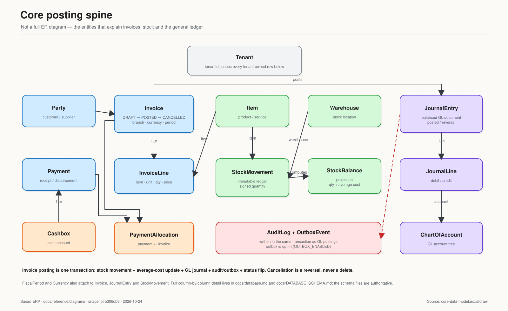

# 04 · Data & Contracts

The database, the shared contract package, the typed clients, and the generated files that connect them.

> Snapshot: `b306db3` · 2026-10-24. **56 Prisma models**, **39 migrations**, **22 enums**, **39 entries** in the contract `resources` map.

---

## The source-of-truth chain

```text
packages/db-prisma/src/schema/*.prisma
        │
        ├── prisma migrate ──► packages/db-prisma/src/schema/migrations/*
        └── prisma generate ─► packages/db-prisma/generated/client/*
                                   │
apps/api DTOs + @Api* decorators ──┘
        │
        └── pnpm generate ──► apps/api/openapi.yaml
                         └──► packages/api-contracts/types/index.ts
                                   │
                 resources/*.resource.ts ──► packages/api-client clients
                                   │
                              apps/dashboard
```

| Stage           | File                                                                        | Regenerated?                                       |
| --------------- | --------------------------------------------------------------------------- | -------------------------------------------------- |
| Schema          | `packages/db-prisma/src/schema/*.prisma`                                    | Hand-authored.                                     |
| Migration       | `packages/db-prisma/src/schema/migrations/<timestamp>_<name>/migration.sql` | `prisma migrate dev`.                              |
| Prisma client   | `packages/db-prisma/generated/client/**`                                    | `prisma generate` / `db:generate`.                 |
| HTTP contract   | `apps/api/openapi.yaml`                                                     | API boot in development + `pnpm generate`.         |
| TS API types    | `packages/api-contracts/types/index.ts`                                     | Same `pnpm generate`.                              |
| Resource routes | `packages/api-contracts/src/resources/*.resource.ts`                        | Hand-authored; constrained by generated `ApiPath`. |
| Clients         | `packages/api-client/src/clients/*.client.ts`                               | Hand-authored, thin.                               |

---

## Database package

```text
packages/db-prisma/
├── prisma.config.ts
├── src/
│   ├── schema/
│   │   ├── schema.prisma           datasource + generator
│   │   ├── *.prisma                56 models across 37 entity files
│   │   └── migrations/             39 migration folders
│   ├── seed/
│   │   ├── index.ts                idempotent seed entry
│   │   ├── seed-ids.ts
│   │   ├── data/                   currency data
│   │   └── seeds/                  tenant, users, roles, units, items, GL, …
│   ├── client/                     Prisma client wrapper
│   ├── nest/                       PrismaModule / PrismaService
│   ├── types/
│   ├── db.ts
│   └── index.ts
├── generated/client/               generated, do not edit
└── package.json
```

### Commands

```bash
pnpm --filter @devloggers/db-prisma db:generate
pnpm --filter @devloggers/db-prisma db:migrate:dev
pnpm --filter @devloggers/db-prisma db:seed
pnpm --filter @devloggers/db-prisma db:studio
pnpm --filter @devloggers/db-prisma db:reset
```

Seeds must stay idempotent. Backfill scripts live in `src/seed/`:

- `backfill-business-setup-tasks.ts`
- `backfill-document-sequences.ts`
- `backfill-invoice-types.ts`

### Schema file map

| Schema file                  | Models                                                             |
| ---------------------------- | ------------------------------------------------------------------ |
| `tenant.prisma`              | `Tenant`                                                           |
| `user.prisma`                | `AppUser`, `Role`, `UserRole`                                      |
| `permission.prisma`          | `Permission`, `RolePermission`                                     |
| `tenant-setting.prisma`      | `TenantSetting`                                                    |
| `financial-setting.prisma`   | `FinancialSetting`                                                 |
| `branch.prisma`              | `Branch`, `BranchWarehouse`                                        |
| `currency.prisma`            | `Currency`                                                         |
| `fiscal-period.prisma`       | `FiscalPeriod`                                                     |
| `document-sequence.prisma`   | `DocumentSequence`                                                 |
| `code-sequence.prisma`       | `CodeSequence`                                                     |
| `unit.prisma`                | `Unit`                                                             |
| `item-category.prisma`       | `ItemCategory`                                                     |
| `item.prisma`                | `Item`                                                             |
| `brand.prisma`               | `Brand`                                                            |
| `tag.prisma`                 | `Tag`                                                              |
| `tag-assignment.prisma`      | `TagAssignment`                                                    |
| `item-relation.prisma`       | `ItemRelation`                                                     |
| `catalog-entity.prisma`      | `CatalogEntity`                                                    |
| `item-catalog-entity.prisma` | `ItemCatalogEntity`                                                |
| `custom-field.prisma`        | `CustomField`, `CustomFieldValue`                                  |
| `warehouse.prisma`           | `Warehouse`, `WarehouseItem`                                       |
| `stock.prisma`               | `StockBalance`, `StockMovement`                                    |
| `stock-count.prisma`         | `StockCount`, `StockCountLine`                                     |
| `party.prisma`               | `Party`                                                            |
| `invoice.prisma`             | `InvoiceType`, `Invoice`, `InvoiceLine`                            |
| `cashbox.prisma`             | `Cashbox`, `Payment`, `PaymentAllocation`                          |
| `bank-account.prisma`        | `BankAccount`                                                      |
| `expense.prisma`             | `Expense`, `ExpenseItem`                                           |
| `accounting.prisma`          | `ChartOfAccount`, `JournalEntry`, `JournalLine`                    |
| `opening-balance.prisma`     | `OpeningBalanceSession`, `OpeningBalanceSessionLine`               |
| `reconciliation.prisma`      | `ReconciliationRun`                                                |
| `outbox.prisma`              | `OutboxEvent`                                                      |
| `audit.prisma`               | `AuditLog`                                                         |
| `ai-agent.prisma`            | `AiConversation`, `AiMessage`, `AiCheckpoint`, `AiCheckpointWrite` |
| `file.prisma`                | `File`                                                             |
| `pos-setting.prisma`         | `PosSetting`                                                       |
| `setup-task.prisma`          | `SetupTask`                                                        |

The 22 enums:

`AccountType`, `JournalEntryStatus`, `ReferenceType`, `AiMessageRole`, `PaymentType`, `PaymentStatus`, `FieldType`, `ExpenseStatus`, `FiscalPeriodStatus`, `InvoiceDirection`, `InvoiceStatus`, `RelationType`, `ItemType`, `OpeningBalanceSessionStatus`, `OpeningBalanceDimension`, `OpeningBalancePartySide`, `OutboxStatus`, `PartyType`, `SetupTaskType`, `SetupTaskStatus`, `StockCountStatus`, `StockMovementType`.

### Tenant scoping

Every tenant-owned model follows the same convention:

```prisma
model Example {
  id        String   @id @default(uuid())
  tenantId  String   @map("tenant_id")
  …
  tenant    Tenant   @relation(fields: [tenantId], references: [id], onDelete: Cascade)

  @@index([tenantId])
  @@map("examples")
}
```

- `CrudRepository` merges `tenantId` into `findMany`, `findById`, and `exists`.
- A raw Prisma query written outside the repository must add `tenantId` explicitly.
- IDs are UUIDs; never assume an ID is globally addressable.
- Tables use `@@map` snake_case, TypeScript fields use camelCase + `@map`.
- Localized names use JSONB `{ ar: string; en?: string }`.

### Important invariants

- `ChartOfAccount` has **no stored current balance**; balances are computed from `JournalLine`. Do not reintroduce a denormalized balance.
- `StockMovement` is the immutable ledger; `StockBalance` is a projection (quantity + average cost).
- Invoice posting is atomic: stock + GL + audit/outbox + status flip.
- Cancellation is a reversal entry, not a delete.
- `AuditLog` is append-only.
- `OutboxEvent` is only written when `OUTBOX_ENABLED=true`; default is off.

### Core posting spine



_Editable: [`diagrams/core-data-model.excalidraw`](diagrams/core-data-model.excalidraw)._

---

## Contracts package

```text
packages/api-contracts/
├── src/
│   ├── resources/                 45 files
│   │   ├── base/resource.ts
│   │   ├── base/crud-resource.ts
│   │   ├── *.resource.ts           route definitions
│   │   └── index.ts                `resources` map (39 entries)
│   ├── dto/                       15 files (shared DTOs, generated schemas)
│   ├── api/                       7 files (envelope, errors, filters, path types)
│   ├── permissions/               permission catalog + defaults
│   ├── settings/                  settings registry
│   ├── custom-fields/             field types + module registry
│   ├── enums/
│   └── index.ts
├── types/index.ts                 generated OpenAPI types (do not edit)
├── package.json
└── tsconfig.json
```

### Resource definition

```ts
export const unitResource = defineCrudResource({
  key: "units",
  routes: {
    list: "/units",
    show: "/units/{id}",
    create: "/units",
    update: "/units/{id}",
    delete: "/units/{id}",
    export: "/units/export" as ApiPath,
    importTemplate: "/units/import/template" as ApiPath,
    import: "/units/import" as ApiPath,
  },
});
```

- `defineCrudResource` requires `list` and `show`; create/update/delete are optional for read-only resources.
- `routes.*` are typed as `ApiPathByMethod<…>`, so a typo or a route missing from the generated contract fails compilation.
- `packages/api-contracts/src/resources/index.ts` exports each resource and builds the `resources` map used by services and clients.
- The generated **operation IDs** are `ControllerName.methodName`, e.g. `Units.list`.

### Typed API utilities

Do not import generated path types directly in a component. Use the helpers exported from `src/api/`:

- `ApiResponse<Path, Method>` — success envelope type.
- `ApiRequestBody<Path, Method>` — request body.
- `ApiQueryParams<Path, Method>` — query string.
- `ApiPath`, `ApiPathByMethod` — route constraints.
- `FilterSchema` — list filter safelist.
- `ApiErrorResponse`, `ApiErrorCode`, `FieldError`.

### Permissions and settings

- `src/permissions/permission-catalog.ts` is the canonical key list.
- `default-role-permissions.ts` seeds built-in roles.
- `src/settings/settings-registry.ts` defines tenant settings groups and relational defaults.
- API guards read the same keys; dashboard navigation uses them cosmetically.

---

## API client package

```text
packages/api-client/
├── src/
│   ├── infra/
│   │   ├── client.ts               ApiClient + ApiError + query serialization
│   │   ├── crud-client.ts          CrudClient + ICrudClient + list types
│   │   └── …
│   ├── clients/
│   │   ├── units.client.ts
│   │   ├── invoices.client.ts
│   │   └── …                       52 files
│   ├── react/                      ApiProvider, useApi, useCrudList
│   ├── api.ts                      createApi() factory
│   ├── server.ts
│   └── index.ts
├── package.json
└── tsconfig.json
```

`createApi()` registers every resource client:

```ts
export function createApi(options?: ApiClientOptions, baseUrl = "http://localhost:4040") {
  const client = new ApiClient(baseUrl, options)
  return {
    client,
    [authResource.key]: new AuthClient(client),
    [unitResource.key]: new UnitsClient(client),
    [itemResource.key]: new ItemsClient(client),
    [invoiceResource.key]: new InvoicesClient(client, invoiceResource),
    …
  } as const
}

export type Api = ReturnType<typeof createApi>
```

Client classes are intentionally thin:

```ts
export class UnitsClient extends CrudClient<typeof unitResource> {
  constructor(apiClient: ApiClient) {
    super(apiClient, unitResource);
  }
}
```

`CrudClient` provides `list`, `show`, `create`, `update`, `destroy`, `bulkDelete`, `bulkUpdate`, `exportExcel`, `downloadImportTemplate`, and `importExcel`. It returns `ApiResponse<Path, Method>`, not `any`.

`ApiClient` uses `openapi-fetch` with a custom deep-object query serializer, so filters become `?filters[status]=POSTED`. `ApiError` exposes `status`, `code`, and `validationErrors` grouped by field for form mapping.

---

## Regeneration workflow

When the API shape changes:

```bash
# 1. API must be running for the contract spec
pnpm generate

# 2. Make new types available to downstream packages
pnpm --filter @devloggers/api-contracts build

# 3. If clients depend on the rebuilt types
pnpm --filter @devloggers/api-client build
```

If a dashboard type is stale, **regenerate; do not cast**. The repo rules forbid `as any`, `as unknown as X`, `@ts-ignore`, or local redefinitions of API payloads.

### Do not edit

```text
packages/api-contracts/types/index.ts
apps/api/openapi.yaml
packages/db-prisma/generated/client/**
```

### Do edit

```text
packages/db-prisma/src/schema/*.prisma
packages/api-contracts/src/resources/*.resource.ts
packages/api-contracts/src/dto/*.ts
apps/api/src/modules/**/dto/*.ts
apps/api/src/modules/**/*.controller.ts
packages/api-client/src/clients/*.client.ts
packages/api-client/src/api.ts
```
