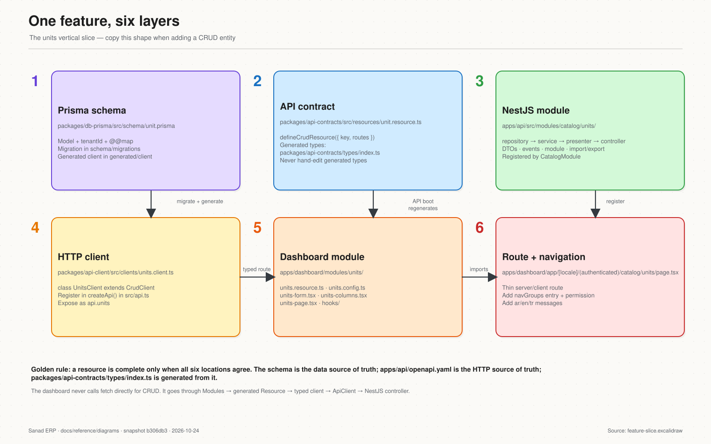

# Codebase Reference

A current, navigable map of the Sanad ERP monorepo. Start here when you need to answer **“where does this live?”**, **“what talks to what?”**, or **“what will this change touch?”**

> **Snapshot:** commit `b306db3` · 2026-10-24  
> **Scope:** source tree, ownership, request flows, generated artifacts, and the units vertical slice.  
> **Not a replacement for:** the Prisma schema, `apps/api/openapi.yaml`, or the code itself — those remain authoritative.

---

## 60-second orientation

Sanad ERP is a **pnpm + Turborepo monorepo** with two real product applications and a small set of shared packages.

```text
apps/dashboard   Next.js 16 App Router UI (Arabic-first, RTL, ar/en/tr)
apps/api         NestJS 11 REST API (13 domain modules)
packages/*       Shared contracts, clients, CRUD infrastructure, DB, i18n
```

A feature normally crosses the stack in this order:

```text
Prisma schema
  → api-contracts resource + DTO
    → NestJS module (repository → service → presenter → controller)
      → api-client CrudClient
        → dashboard module (generateResource + form + columns)
          → App Router page + navigation
```

The **units** feature is the golden reference for a CRUD slice. Copy its shape, not just its files.

---

## This folder

```text
docs/reference/
├── README.md                  ← start here
├── 01-monorepo.md             top-level tree, packages, dependency direction
├── 02-api.md                  domains, routes, module anatomy, request pipeline
├── 03-dashboard.md            route groups, modules, data-view, forms
├── 04-data-and-contracts.md   Prisma, contracts, generated types, clients
├── 05-workflows.md            auth, CRUD, invoices, stock, payments, setup, AI
├── 06-find-it-fast.md         task-first index + change checklists
└── diagrams/
    ├── README.md              diagram conventions + regeneration
    ├── build-diagrams.mjs     deterministic Excalidraw/SVG generator
    ├── *.excalidraw           editable sources (6)
    └── *.svg                  rendered images embedded here (6)
```

| Layer       | Golden path                                                          |
| ----------- | -------------------------------------------------------------------- |
| Database    | `packages/db-prisma/src/schema/unit.prisma`                          |
| Contract    | `packages/api-contracts/src/resources/unit.resource.ts`              |
| API         | `apps/api/src/modules/catalog/units/`                                |
| HTTP client | `packages/api-client/src/clients/units.client.ts`                    |
| Dashboard   | `apps/dashboard/modules/units/`                                      |
| Route       | `apps/dashboard/app/[locale]/(authenticated)/catalog/units/page.tsx` |

---

## Read this when…

| Question                                                            | Document                                          |
| ------------------------------------------------------------------- | ------------------------------------------------- |
| What are all the top-level folders and packages?                    | [01 · Monorepo map](01-monorepo.md)               |
| Where is a specific API domain, module, or route?                   | [02 · API atlas](02-api.md)                       |
| Where is a dashboard page, module, form, or shared component?       | [03 · Dashboard atlas](03-dashboard.md)           |
| Where are the schema, contracts, generated types, and clients?      | [04 · Data & contracts](04-data-and-contracts.md) |
| How does a request, invoice posting, stock movement, or login work? | [05 · Core workflows](05-workflows.md)            |
| I know what I want to change, not where it lives.                   | [06 · Find it fast](06-find-it-fast.md)           |
| I want the editable diagrams.                                       | [Diagrams](diagrams/README.md)                    |

---

## The map in one picture



_Editable source: [`diagrams/feature-slice.excalidraw`](diagrams/feature-slice.excalidraw)._

More visuals:

| Diagram                                                   | What it answers                                                 |
| --------------------------------------------------------- | --------------------------------------------------------------- |
| [System context](diagrams/system-context.svg)             | Which apps, packages, data stores, and external services exist? |
| [Feature slice](diagrams/feature-slice.svg)               | What six locations must agree for a CRUD resource?              |
| [Request lifecycle](diagrams/request-lifecycle.svg)       | What happens between a click and a PostgreSQL commit?           |
| [Domain map](diagrams/domain-map.svg)                     | How do the 13 API domains depend on each other?                 |
| [Core posting spine](diagrams/core-data-model.svg)        | How do invoices, stock, and the GL connect?                     |
| [Codebase composition](diagrams/codebase-composition.svg) | Where is the source volume concentrated?                        |

All diagrams have an **editable `.excalidraw` source** and a rendered **`.svg`** for Markdown. Regenerate with:

```bash
node docs/reference/diagrams/build-diagrams.mjs
```

---

## What is actually active

| Area                     | Status            | Notes                                                                                                   |
| ------------------------ | ----------------- | ------------------------------------------------------------------------------------------------------- |
| `apps/api`               | Active            | 13 domain modules, 56 Prisma-backed models, Swagger + generated contract.                               |
| `apps/dashboard`         | Active            | 38 feature modules, 58 pages (52 authenticated), shared data-view system.                               |
| `apps/desktop`           | Thin wrapper      | Electron loads `DASHBOARD_URL` (default `http://localhost:3000`).                                       |
| `apps/n8n`               | Optional ops tool | Local Docker Compose stack with its own PostgreSQL. Not a code dependency.                              |
| `packages/db-prisma`     | Active            | Schema, migrations, seed, generated Prisma client.                                                      |
| `packages/api-contracts` | Active            | Resource definitions, DTOs, permissions, generated OpenAPI types.                                       |
| `packages/backend-core`  | Active            | CRUD base classes, response envelope, filters, import/export.                                           |
| `packages/api-client`    | Active            | Typed `CrudClient` subclasses + React bindings.                                                         |
| `packages/i18n`          | Active            | `ar`, `en`, `tr` messages and Nest/next-intl adapters.                                                  |
| `packages/ui`            | Starter           | Three minimal components; most dashboard UI lives in `apps/dashboard/shared/components`.                |
| `packages/contracts`     | Inactive artifact | Contains only `dist/`; no `package.json` or source. Do not treat it as an active workspace.             |
| `packages/import-export` | Inactive artifact | Contains only `dist/` + `node_modules`; no manifest/source. Import/export code lives in `backend-core`. |

The workspace globs are `apps/*` and `packages/*`, but pnpm only treats a directory as a package when it has a `package.json`.

---

## Source-of-truth rules

When two files disagree, use this order:

| Topic                      | Trust this                                                           | Not this                                                   |
| -------------------------- | -------------------------------------------------------------------- | ---------------------------------------------------------- |
| Database shape             | `packages/db-prisma/src/schema/*.prisma` + migrations                | Prose schema docs                                          |
| HTTP shape                 | `apps/api/openapi.yaml` (generated from Swagger)                     | Hand-written endpoint tables                               |
| API request/response types | `packages/api-contracts/types/index.ts` (generated)                  | Inline interfaces or `as any`                              |
| Routes actually mounted    | `@Controller(...)` in `apps/api/src/modules/**` + `DOMAIN_MANIFESTS` | Navigation labels alone                                    |
| Dashboard pages            | `apps/dashboard/app/[locale]/**/page.tsx`                            | `navGroups.tsx` alone (it includes permission-gated links) |
| Tenant scoping             | `tenantId` in the schema and `CrudRepository`                        | Assumptions that an ID is globally unique                  |

Generated files must not be hand-edited:

- `packages/api-contracts/types/index.ts`
- `apps/api/openapi.yaml`
- `packages/db-prisma/generated/client/**`

---

## Documentation drift

Some older pages predate the current domain registry, AI agent, outbox, branches, and POS work. Use them for narrative context, but verify paths and model names here.

| Older page                                         | Status                                                                                         |
| -------------------------------------------------- | ---------------------------------------------------------------------------------------------- |
| [`docs/file-structure.md`](../file-structure.md)   | Historical overview; this folder supersedes its tree.                                          |
| [`docs/architecture.md`](../architecture.md)       | Still useful for layer concepts; some examples are simplified.                                 |
| [`docs/modules.md`](../modules.md)                 | Useful domain summaries; verify against `apps/api/src/modules/` and `apps/dashboard/modules/`. |
| [`docs/DATABASE_SCHEMA.md`](../DATABASE_SCHEMA.md) | Historical table detail; the Prisma files are authoritative.                                   |
| [`docs/api.md`](../api.md)                         | Endpoint examples; `apps/api/openapi.yaml` is authoritative.                                   |

---

## Maintenance

This reference is a **snapshot**, not a live index. Update it when:

1. a new top-level app/package or domain is added;
2. a resource is added or moved across layers;
3. the Prisma model count or migrations change materially;
4. a route group, module, or navigation area is renamed;
5. the diagrams’ dependency edges no longer match `apps/api/src/domain/manifest.ts`.

Refresh the diagrams:

```bash
node docs/reference/diagrams/build-diagrams.mjs
```

Refresh the generated API contract:

```bash
pnpm generate
```

Then update the snapshot commit/date at the top of this file.
