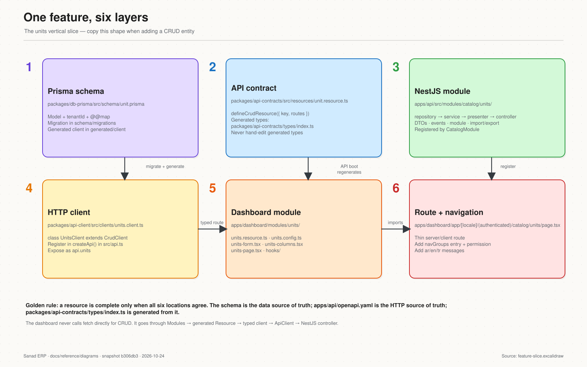

# Reference Diagrams

Editable [Excalidraw](https://excalidraw.com) sources and rendered SVGs for the codebase reference.

Every diagram exists twice:

| File                 | Purpose                                              |
| -------------------- | ---------------------------------------------------- |
| `<name>.excalidraw`  | Open in Excalidraw to inspect, pan, move, or export. |
| `<name>.svg`         | Embedded in the Markdown docs; renders on GitHub.    |
| `build-diagrams.mjs` | Deterministic generator for both files.              |

The **build script is the reproducible source**. The `.excalidraw` files are generated outputs — you can open and edit them visually, but re-running the script will rebuild them from the specs.

---

## Diagrams

| Diagram              | Preview                                                                         | Covers                                                |
| -------------------- | ------------------------------------------------------------------------------- | ----------------------------------------------------- |
| System context       | [SVG](system-context.svg) · [Excalidraw](system-context.excalidraw)             | Apps, packages, PostgreSQL, storage, AI, outbox, n8n. |
| Feature slice        | [SVG](feature-slice.svg) · [Excalidraw](feature-slice.excalidraw)               | The six units-slice layers.                           |
| Request lifecycle    | [SVG](request-lifecycle.svg) · [Excalidraw](request-lifecycle.excalidraw)       | Browser → Next → Nest → service → PostgreSQL → cache. |
| Domain map           | [SVG](domain-map.svg) · [Excalidraw](domain-map.excalidraw)                     | 13 API domains + main dependency edges.               |
| Core posting spine   | [SVG](core-data-model.svg) · [Excalidraw](core-data-model.excalidraw)           | Invoice, stock, payment, and GL entities.             |
| Codebase composition | [SVG](codebase-composition.svg) · [Excalidraw](codebase-composition.excalidraw) | API domain LOC + workspace source files/tests.        |

From inside `01`–`06`, link with `diagrams/feature-slice.svg`. From this directory, or from `README.md` beside it, use:

```md

```

---

## Regenerate

```bash
node docs/reference/diagrams/build-diagrams.mjs
```

No dependencies. The script writes into this directory.

### What is hard-coded

- Layout coordinates and labels.
- Domain dependency edges.
- Model counts, migration counts, LOC/file counts.
- Snapshot commit/date in the footer.

When those change, update the relevant spec in `build-diagrams.mjs` and re-run. The Markdown docs should then be checked for stale numbers.

### Validate

```bash
# valid JSON
node -e "JSON.parse(require('fs').readFileSync('docs/reference/diagrams/system-context.excalidraw','utf8'))"

# valid XML
node -e "const s=require('fs').readFileSync('docs/reference/diagrams/system-context.svg','utf8'); if(!s.includes('<svg')) process.exit(1)"
```

---

## Visual conventions

| Color  | Meaning                                           |
| ------ | ------------------------------------------------- |
| Blue   | Core required domain / primary application layer. |
| Green  | Request path / source-of-truth step.              |
| Orange | Optional domain, outbox, or supporting flow.      |
| Purple | Persistence / GL / contracts.                     |
| Red    | Failure surface or sidecar transaction.           |
| Yellow | Client layer / mapping step.                      |

- Rounded rectangles are boxes in Excalidraw.
- Arrows are runtime/config/dependency edges, not necessarily import statements.
- Solid = primary flow; dashed = optional/asynchronous/reversal.
- Footer includes the snapshot commit so stale diagrams are obvious.

---

## Editing in Excalidraw

1. Open <https://excalidraw.com>.
2. **File → Open** and choose a `.excalidraw` file.
3. Move/rename/resize as needed.
4. **Export → SVG** if you want a replacement render.
5. If the change should survive regeneration, update `build-diagrams.mjs` as well.

The diagrams intentionally avoid embedding external images, so the `.excalidraw` files are self-contained JSON.
